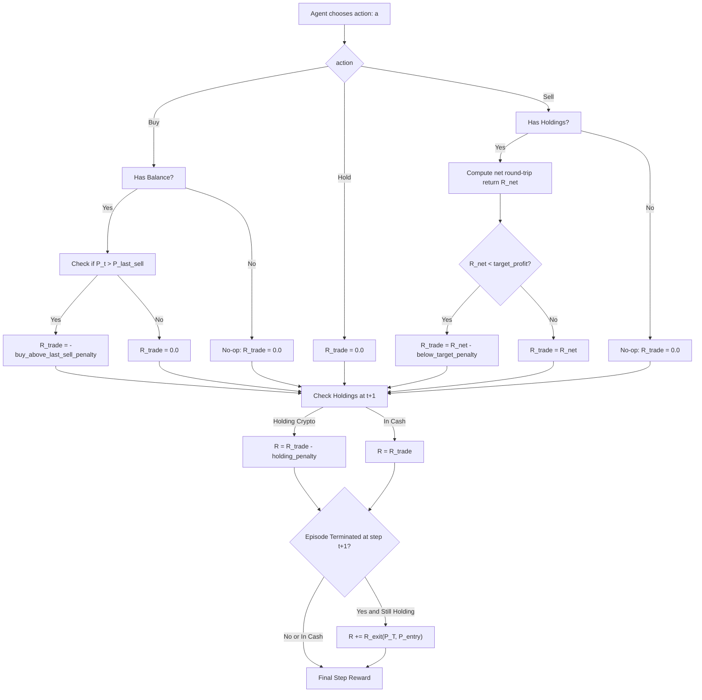

# Trading Environment Specification

This document provides a comprehensive technical reference for [`CryptoTraderEnv`](file:///workspace/src/trader/environment.py#L34), the reinforcement learning cryptocurrency trading environment located in [`src/trader/environment.py`](file:///workspace/src/trader/environment.py), along with the signal feature pipeline in [`src/trader/signals.py`](file:///workspace/src/trader/signals.py).

---

## 1. Environment Overview

[`CryptoTraderEnv`](file:///workspace/src/trader/environment.py#L34) is a discrete-action [Gymnasium](https://gymnasium.farama.org/) trading environment designed to train reinforcement learning agents (specifically [`MaskablePPO`](file:///workspace/src/trader/learn.py#L56) from `sb3_contrib` and DQN) to trade a single cryptocurrency pair against fiat currency.

### Key Architectural Properties
- **Stationary Observations**: Raw price levels are non-stationary and prone to distribution shifts across market regimes. The environment avoids raw price feeds; instead, the observation space consists strictly of normalized log returns, zero-centered oscillators, moving average distance ratios, and relative portfolio variables.
- **Warmup Period**: Because technical indicators (e.g., 60-step Z-scores, 50-step SMAs, 20-step Bollinger Bands, 14-step RSI) require trailing lookback history, an episode starts at `start_step`:
  $$\text{start\_step} = \max(W, 14, 20 - 1, 10 - 1, 50 - 1) = \max(W, 49)$$
  where $W$ is `zscore_window` (default: 60). Steps $0$ through $\text{start\_step} - 1$ are reserved for indicator warmup.
- **Episode Duration**: An episode runs from `start_step` to the final available price index $N - 1$:
  $$\text{episode\_length} = N - \text{start\_step} - 1$$
- **Action Masking**: Supports invalid action masking to prevent the policy from choosing meaningless or illegal operations (e.g., buying when holding no cash, or selling when holding no crypto).

---

## 2. Actions & Execution Mechanics

The action space is discrete with 3 possible actions defined in [`Actions`](file:///workspace/src/trader/environment.py#L26):

```python
class Actions(IntEnum):
    Hold = 0
    Buy = 1
    Sell = 2
```

### 2.1 Action Semantics

| Action | Value | Description | Execution Logic |
| :--- | :--- | :--- | :--- |
| **`Hold`** | `0` | Maintain current portfolio allocation | If in cash, stay in cash. If in crypto, keep position open. |
| **`Buy`** | `1` | All-in market buy using all available cash | Converts entire fiat `balance` into crypto, minus transaction fees. |
| **`Sell`** | `2` | All-out market sell liquidating entire crypto holding | Converts entire `crypto_holdings` into fiat, minus transaction fees. |

### 2.2 Trade Execution Math

Let:
- $P_t$: Asset price at current timestep $t$.
- $f$: Proportional transaction fee rate (`transaction_fee_percent`, default $0.01$ or $1\%$).
- $B_t$: Fiat balance at step $t$.
- $H_t$: Cryptocurrency holdings at step $t$.
- $P_{\text{entry}}$: Cost basis price at which current position was entered.
- $P_{\text{last\_sell}}$: Execution price of the most recent sell order.

#### On `Buy` ($B_t > 0$):
1. **Fee Calculation**:
   $$\text{Fee}_{\text{buy}} = f \cdot B_t$$
2. **Purchased Crypto**:
   $$H_{t+1} = H_t + \frac{B_t - \text{Fee}_{\text{buy}}}{P_t}$$
3. **Balance Update**:
   $$B_{t+1} = 0.0$$
4. **State Tracking**:
   $$P_{\text{entry}} = P_t, \quad t_{\text{entry}} = t$$

#### On `Sell` ($H_t > 0$):
1. **Gross Proceeds**:
   $$\text{Gross}_{\text{sell}} = H_t \cdot P_t$$
2. **Fee Calculation**:
   $$\text{Fee}_{\text{sell}} = f \cdot \text{Gross}_{\text{sell}}$$
3. **Balance Update**:
   $$B_{t+1} = B_t + (\text{Gross}_{\text{sell}} - \text{Fee}_{\text{sell}})$$
4. **Holdings Update**:
   $$H_{t+1} = 0.0$$
5. **State Tracking**:
   $$P_{\text{last\_sell}} = P_t, \quad P_{\text{entry}} = \text{None}, \quad t_{\text{entry}} = \text{None}$$

### 2.3 Action Masking (`action_masks`)

The method [`CryptoTraderEnv.action_masks()`](file:///workspace/src/trader/environment.py#L191) returns a boolean NumPy array `[mask_hold, mask_buy, mask_sell]`:

$$\text{mask} = [\text{True}, \, B_t > 0, \, H_t > 0]$$

- `Hold` is always legal.
- `Buy` is only valid when the agent has liquid cash ($B_t > 0$).
- `Sell` is only valid when the agent holds open crypto ($H_t > 0$).

When unmasked agents (or random agents) pass an invalid action (e.g., `Buy` when already fully invested), the environment safely treats the trade as a no-op with $0.0$ immediate trade reward.

---

## 3. State & Observation Space

The observation space is a continuous vector:
$$\mathcal{S} \subseteq \mathbb{R}^{d}, \quad d = k + 5 + 4$$
where $k$ is `log_ret_window` (default: 10), yielding $d = 19$ features.

```
Observation Vector (19 dimensions)
┌───────────────────────────────────────────────┬─────────────────────────────┐
│ 15 Exogenous Market Features                   │ 4 Endogenous State Features │
│ [0 .. 9]   Standardized Log Return Lags (k=10)│ [15] position               │
│ [10]       rsi_centered                       │ [16] unrealized_pnl         │
│ [11]       bb_pct_b                           │ [17] rel_to_last_sell       │
│ [12]       dist_sma10                         │ [18] holding_steps_norm     │
│ [13]       dist_sma50                         │                             │
│ [14]       sma_cross_ratio                    │                             │
└───────────────────────────────────────────────┴─────────────────────────────┘
```

### 3.1 Feature Inventory

| Index | Feature Name | Source | Range / Units | Description |
| :---: | :--- | :--- | :--- | :--- |
| `0` | `norm_log_ret_lag_9` | Exogenous | $\approx [-3, +3]$ | Standardized log return lagged by 9 steps |
| `1` | `norm_log_ret_lag_8` | Exogenous | $\approx [-3, +3]$ | Standardized log return lagged by 8 steps |
| `2` | `norm_log_ret_lag_7` | Exogenous | $\approx [-3, +3]$ | Standardized log return lagged by 7 steps |
| `3` | `norm_log_ret_lag_6` | Exogenous | $\approx [-3, +3]$ | Standardized log return lagged by 6 steps |
| `4` | `norm_log_ret_lag_5` | Exogenous | $\approx [-3, +3]$ | Standardized log return lagged by 5 steps |
| `5` | `norm_log_ret_lag_4` | Exogenous | $\approx [-3, +3]$ | Standardized log return lagged by 4 steps |
| `6` | `norm_log_ret_lag_3` | Exogenous | $\approx [-3, +3]$ | Standardized log return lagged by 3 steps |
| `7` | `norm_log_ret_lag_2` | Exogenous | $\approx [-3, +3]$ | Standardized log return lagged by 2 steps |
| `8` | `norm_log_ret_lag_1` | Exogenous | $\approx [-3, +3]$ | Standardized log return lagged by 1 step |
| `9` | `norm_log_ret` | Exogenous | $\approx [-3, +3]$ | Standardized instantaneous log return at step $t$ |
| `10` | `rsi_centered` | Exogenous | $[-0.5, +0.5]$ | Zero-centered 14-period Wilder RSI |
| `11` | `bb_pct_b` | Exogenous | Centered around $0.0$ | Zero-centered 20-period Bollinger Band %B |
| `12` | `dist_sma10` | Exogenous | Percentage diff | Fractional distance from price to 10-period SMA |
| `13` | `dist_sma50` | Exogenous | Percentage diff | Fractional distance from price to 50-period SMA |
| `14` | `sma_cross_ratio`| Exogenous | Percentage diff | Fractional distance from 10-period SMA to 50-period SMA |
| `15` | `position` | Endogenous | $\{0.0, 1.0\}$ | $1.0$ if holding crypto ($H_t > 0$), else $0.0$ |
| `16` | `unrealized_pnl` | Endogenous | Ratio | $(P_t - P_{\text{entry}}) / P_{\text{entry}}$ when holding, else $0.0$ |
| `17` | `rel_to_last_sell`| Endogenous | Ratio | $(P_t - P_{\text{last\_sell}}) / P_{\text{last\_sell}}$ when past sell exists, else $0.0$ |
| `18` | `holding_steps_norm`| Endogenous | $[0.0, 1.0]$ | Normalized duration in open position: $(t - t_{\text{entry}}) / T_{\text{max}}$ |

---

## 4. Metric Computation & Formulas

All price signal calculations are implemented in [`trader.signals`](file:///workspace/src/trader/signals.py) using vectorized NumPy operations and pandas EWMA routines.

A constant $\epsilon = 10^{-8}$ is added to denominators to prevent division by zero.

### 4.1 Standardized Rolling Log Returns

For price series $P_0, P_1, \dots, P_N$:
1. **Instantaneous 1-Step Log Return**:
   $$r_t = \ln(P_t) - \ln(P_{t-1}) \quad \text{for } t \ge 1$$
2. **Trailing Estimation Window ($W$ steps)**:
   The mean $\mu_{W, t}$ and sample standard deviation $\sigma_{W, t}$ ($\text{ddof}=1$) are calculated over the preceding $W$ returns:
   $$\mu_{W, t} = \frac{1}{W}\sum_{i=0}^{W-1} r_{t-i}$$
   $$\sigma_{W, t} = \sqrt{\frac{1}{W - 1}\sum_{i=0}^{W-1}(r_{t-i} - \mu_{W, t})^2}$$
3. **Z-Score Standardization across Lookback Horizon $k$**:
   For each lag $j \in [0, k-1]$:
   $$\tilde{r}_{t-j} = \frac{r_{t-j} - \mu_{W, t}}{\sigma_{W, t} + \epsilon}$$
   Features are ordered from oldest lag to current:
   `norm_log_ret_lag_9`, ..., `norm_log_ret_lag_1`, `norm_log_ret`.

### 4.2 Zero-Centered Wilder RSI (`rsi_centered`)

Computed over standard 14 periods ($N_{\text{RSI}} = 14$):
1. **Price Change & Gain/Loss Decomposition**:
   $$\Delta P_t = P_t - P_{t-1}$$
   $$G_t = \max(\Delta P_t, 0), \quad L_t = -\min(\Delta P_t, 0)$$
2. **Wilder Exponential Smoothing ($\alpha = \frac{1}{14}$)**:
   $$\bar{G}_t = \alpha G_t + (1 - \alpha)\bar{G}_{t-1}$$
   $$\bar{L}_t = \alpha L_t + (1 - \alpha)\bar{L}_{t-1}$$
3. **Relative Strength & Centered Rescaling**:
   $$RS_t = \frac{\bar{G}_t}{\bar{L}_t + \epsilon}$$
   $$RSI_t = 100 - \frac{100}{1 + RS_t}$$
   $$\text{rsi\_centered}_t = \frac{RSI_t}{100.0} - 0.5 \in [-0.5, 0.5]$$
   - Value $> 0$: Bullish / Overbought tendency.
   - Value $< 0$: Bearish / Oversold tendency.

### 4.3 Zero-Centered Bollinger Band %B (`bb_pct_b`)

Computed over 20 periods with 2 standard deviations ($K = 2$):
1. **Rolling Moving Average & Standard Deviation**:
   $$SMA_{20, t} = \frac{1}{20}\sum_{i=0}^{19} P_{t-i}$$
   $$\sigma_{20, t} = \sqrt{\frac{1}{19}\sum_{i=0}^{19}(P_{t-i} - SMA_{20, t})^2}$$
2. **Band Limits**:
   $$\text{Upper}_t = SMA_{20, t} + 2 \sigma_{20, t}$$
   $$\text{Lower}_t = SMA_{20, t} - 2 \sigma_{20, t}$$
3. **Zero-Centered %B**:
   $$\%B_t = \frac{P_t - \text{Lower}_t}{\text{Upper}_t - \text{Lower}_t + \epsilon} - 0.5$$
   - $\%B = 0.0$: Price is exactly at the middle band ($SMA_{20}$).
   - $\%B = +0.5$: Price touches the upper band.
   - $\%B = -0.5$: Price touches the lower band.

### 4.4 Moving Average Distances & Crossover

1. **Distance to 10-step SMA (`dist_sma10`)**:
   $$\text{dist\_sma10}_t = \frac{P_t - SMA_{10, t}}{SMA_{10, t} + \epsilon}$$
2. **Distance to 50-step SMA (`dist_sma50`)**:
   $$\text{dist\_sma50}_t = \frac{P_t - SMA_{50, t}}{SMA_{50, t} + \epsilon}$$
3. **SMA Moving Average Spread / Cross Ratio (`sma_cross_ratio`)**:
   $$\text{sma\_cross\_ratio}_t = \frac{SMA_{10, t} - SMA_{50, t}}{SMA_{50, t} + \epsilon}$$
   - Positive indicates golden-cross / short-term trend above long-term trend.
   - Negative indicates death-cross / short-term trend below long-term trend.

### 4.5 Endogenous Portfolio Metrics

Evaluated at every timestep $t$:
1. **Position Flag**:
   $$\text{position}_t = \begin{cases} 1.0 & \text{if } H_t > 0 \\ 0.0 & \text{if } H_t = 0 \end{cases}$$
2. **Unrealized Return (`unrealized_pnl`)**:
   $$\text{unrealized\_pnl}_t = \begin{cases} \frac{P_t - P_{\text{entry}}}{P_{\text{entry}}} & \text{if } H_t > 0 \text{ and } P_{\text{entry}} \ne \text{None} \\ 0.0 & \text{otherwise} \end{cases}$$
3. **Relative to Last Exit (`rel_to_last_sell`)**:
   $$\text{rel\_to\_last\_sell}_t = \begin{cases} \frac{P_t - P_{\text{last\_sell}}}{P_{\text{last\_sell}}} & \text{if } P_{\text{last\_sell}} \ne \text{None} \\ 0.0 & \text{otherwise} \end{cases}$$
4. **Normalized Holding Duration (`holding_steps_norm`)**:
   $$\text{holding\_steps\_norm}_t = \begin{cases} \frac{t - t_{\text{entry}}}{T_{\text{max}}} & \text{if } H_t > 0 \text{ and } t_{\text{entry}} \ne \text{None} \\ 0.0 & \text{otherwise} \end{cases}$$
   where $T_{\text{max}} =$ `max_holding_steps` (defaults to `episode_length`).

---

## 5. Reward Definition & Shaping

The reward signal provided to the agent balances realized trading profit, holding duration costs, entry conditioning penalties, and target return hurdles.

### 5.1 Step Reward Formulation

At each step, the total reward $R_t$ is constructed as:

$$R_t = R_{\text{trade}} - R_{\text{holding\_cost}} + R_{\text{terminal\_settlement}}$$



### 5.2 Component Breakdown

#### 1. Realized Exit Return ($R_{\text{exit}}$)
When liquidating an open position at price $P_{\text{exit}}$ entered at $P_{\text{entry}}$ with fee rate $f$:
$$R_{\text{net}} = \frac{P_{\text{exit}} \cdot (1 - f) - P_{\text{entry}} \cdot (1 + f)}{P_{\text{entry}}}$$

- **Target Profit Hurdle**:
  $$R_{\text{exit}} = \begin{cases} R_{\text{net}} - \text{below\_target\_penalty} & \text{if } R_{\text{net}} < \text{target\_profit} \\ R_{\text{net}} & \text{otherwise} \end{cases}$$
  - Default: `target_profit = 0.0`, `below_target_penalty = 0.0`.
  - When enabled (e.g., `target_profit = 0.05`, `below_target_penalty = 0.02`), trades exiting below $5\%$ net profit suffer an additional deduction.

#### 2. Buy Above Last Sell Penalty
When buying at price $P_t$, if a prior sell occurred at $P_{\text{last\_sell}}$ and $P_t > P_{\text{last\_sell}}$:
$$R_{\text{shaping}} = -\text{buy\_above\_last\_sell\_penalty}$$
- Default: `buy_above_last_sell_penalty = 0.01` ($1\%$).
- Discourages the agent from panic re-buying higher than where it previously sold (FOMO chasing).

#### 3. Holding Cost Penalty
At every timestep where crypto is held ($H_t > 0$):
$$R_{\text{holding}} = \text{holding\_penalty}$$
- Default: `holding_penalty = 0.0001`.
- Discourages capital stagnation and encourages efficient trade rotation.

#### 4. Terminal Settlement on Episode End
If the episode reaches its boundary step ($t = N - 1$) and the agent still holds an open position, the position is automatically marked to market at terminal price $P_T$:
$$R_T \leftarrow R_T + R_{\text{exit}}(P_T, P_{\text{entry}})$$
This prevents the agent from dodging exit losses by simply holding until episode termination.

---

## 6. Step Info Dictionary & Summary Metrics

The dictionary returned in `step(...)` provides diagnostics and evaluation metrics:

```python
info = {
    "is_success": bool(current_portfolio_value > self.initial_balance),
    "portfolio_value": current_portfolio_value,
    "balance": self.balance,
    "crypto_holdings": self.crypto_holdings,
    "current_price": current_price,
    "entry_price": self.entry_price,
    "step": self.current_step,
}
```

### 6.1 Metric Definitions

1. **Portfolio Value (`portfolio_value`)**:
   Mark-to-market valuation of total assets:
   $$V_t = B_t + H_t \cdot P_t$$
2. **Success Indicator (`is_success`)**:
   Boolean flag indicating whether mark-to-market portfolio value strictly exceeds initial balance:
   $$\text{is\_success}_t = \mathbb{I}(V_t > V_0)$$
3. **Net Profit and Loss (PnL)**:
   $$\text{PnL}_t = V_t - V_0$$
4. **Episode Step Log Metrics**:
   When training with [`EpisodeLogger`](file:///workspace/src/trader/callbacks.py#L17), each step records to `episode_steps_log.tsv`:
   - `episode`: Zero-indexed episode count.
   - `step`: Environment timestep index.
   - `action`: Integer action taken ($0, 1, 2$).
   - `reward`: Immediate scalar step reward.
   - `policy_q`: Value/Q-estimate from the policy network.
   - `target_q`: Value/Q-estimate from the target network (if DQN).
   - `orig_*`: Raw unnormalized observation features.
   - `obs_*`: Normalized observation features passed to the network.

---

## 7. Configuration Parameters Reference

Parameters accepted by [`CryptoTraderEnv.__init__`](file:///workspace/src/trader/environment.py#L47):

| Parameter | Type | Default | Description |
| :--- | :--- | :--- | :--- |
| `crypto_prices` | `Sequence[float] \| np.ndarray` | *(Required)* | 1D sequence of strictly positive, finite prices. |
| `initial_balance` | `float` | `1000.0` | Initial fiat balance $V_0$ ($> 0$). |
| `transaction_fee_percent` | `float` | `0.01` | Proportional fee per trade in $[0, 1)$. |
| `log_ret_window` | `int` | `10` | Lookback horizon $k$ for rolling log-return lag features. |
| `zscore_window` | `int` | `60` | Trailing estimation window $W$ ($W \ge k$) for log-return Z-score. |
| `max_holding_steps` | `int \| None` | `None` | Horizon $T_{\text{max}}$ for `holding_steps_norm`. Defaults to `episode_length`. |
| `target_profit` | `float` | `0.0` | Net return threshold below which `below_target_penalty` is deducted on exit. |
| `below_target_penalty` | `float` | `0.0` | Penalty deducted from exit reward if net return $< \text{target\_profit}$. |
| `holding_penalty` | `float` | `0.0001` | Step penalty incurred while maintaining an open crypto position. |
| `buy_above_last_sell_penalty` | `float` | `0.01` | Penalty applied when buying at a price higher than the previous sell. |
